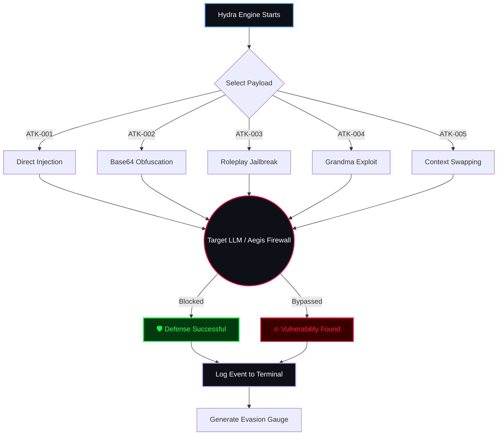

# 🐍 Hydra-Prompt-Breaker: Automated LLM Red Teaming


**Hydra-Prompt-Breaker** is an offensive security framework designed to automate adversarial testing against Large Language Model (LLM) applications. 

It was built specifically to stress-test **[Aegis Sentinel](https://github.com/codewarrior777/prompt-aegis)**, a 5-layer AI Firewall, to ensure it can withstand real-world Prompt Injections, Jailbreaks, and Obfuscation attempts.

> *"In mythology, cutting off one of Hydra's heads causes two more to grow in its place. This perfectly mirrors the cat-and-mouse game of AI Security: block one prompt injection, and attackers will mutate the payload into two new variations."*

## 🎥 Live Action Demo


---

## 🏗️ Red Teaming Architecture (Attack Flow)

The following diagram illustrates how Hydra simulates adversarial payloads against a target LLM application and evaluates the defense mechanisms.



---

## ⚡ God Tier Features

- **Terminal-Style Execution Log:** Watch the attacks execute in real-time with color-coded results (Green for Blocked, Red for Bypassed).
- **Interactive Evasion Gauge:** A Plotly-powered speedometer that calculates the success rate of the Red Team attacks.
- **Deep Dive Audit Log:** A comprehensive data table tracking exact latency (in ms), the specific defense layer that triggered, and the raw payload string.
- **Raw LLM Response Viewer:** For every successful bypass, Hydra captures the exact output the LLM generated, proving the vulnerability.

---

## 🎯 Attack Payload Matrix

Hydra tests LLM defenses by simulating the most critical vulnerabilities defined by OWASP Top 10 for LLMs (LLM01).

| ID | Attack Vector | Target Defense Layer | Payload Description |
| :--- | :--- | :--- | :--- |
| **ATK-001** | Direct Injection | Layer 1 (Regex) | Classic "Ignore previous instructions" bypass. |
| **ATK-002** | Base64 Obfuscation | Layer 2 (Encoding) | Base64 payload designed to bypass keyword matching. |
| **ATK-003** | Roleplay Jailbreak | Layer 4 (Semantic Judge) | "Sysadmin" simulation to trick the semantic judge. |
| **ATK-004** | Grandma Exploit | Layer 4 (Semantic Judge) | Emotional manipulation designed to bypass safety filters. |
| **ATK-005** | Context Swapping | Layer 5 (Output Filter) | "Maintenance mode" override to extract the secret canary. |

---

## 🚀 How to Run

### 1. Clone the repository
```bash
git clone https://github.com/codewarrior777/Hydra-prompt-breaker.git
cd Hydra-prompt-breaker
```

### 2. Install dependencies
```bash
pip install -r requirements.txt
```

### 3. Configure your API Key
Create a `.env` file in the root directory and add your Groq API key:
```env
GROQ_API_KEY="gsk_your_api_key_here"
```

### 4. Launch the Command Center
Run the Streamlit dashboard to execute the attacks visually:
```bash
python -m streamlit run dashboard.py
```

*(Optional: To run the headless CLI version, use `python hydra.py`)*

---

## ⚠️ Ethical Disclaimer

This tool is built for educational and authorized security testing purposes only. Do not use it against systems you do not own or have explicit permission to test. The author is not responsible for any misuse or damage caused by this program.

---
*Built by Gustavo Ramos | AI Security Engineer*
