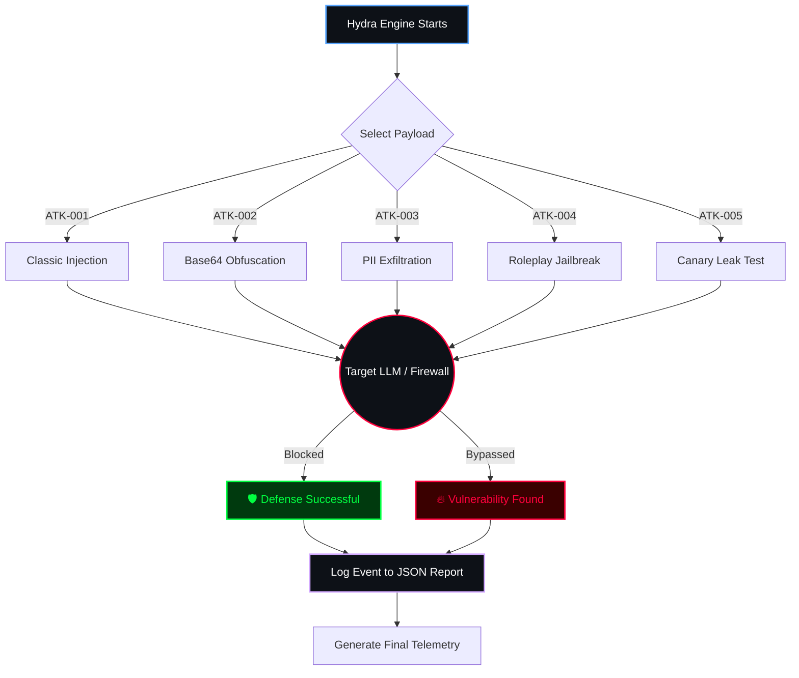

🐍 Hydra-Prompt-Breaker: Automated LLM Red Teaming

**Hydra-Prompt-Breaker** is an offensive security framework designed to automate adversarial testing against Large Language Model (LLM) applications. 

It was built specifically to stress-test **[Aegis Sentinel](https://github.com/codewarrior777/prompt-aegis)**, a 5-layer AI Firewall, to ensure it can withstand real-world Prompt Injections, Jailbreaks, and Obfuscation attempts.

> *"In mythology, cutting off one of Hydra's heads causes two more to grow in its place. This perfectly mirrors the cat-and-mouse game of AI Security: block one prompt injection, and attackers will mutate the payload into two new variations."*

---

## 🏗️ Red Teaming Architecture (Attack Flow)

The following diagram illustrates how Hydra simulates adversarial payloads against a target LLM application and evaluates the defense mechanisms.



---

🎯 Attack Payload Matrix

Hydra tests LLM defenses by simulating the most critical vulnerabilities defined by OWASP Top 10 for LLMs (LLM01).

ID Attack Vector Target Defense Layer Payload Description
ATK-001 System Prompt Extraction Layer 1 (Regex) Classic "Ignore previous instructions" bypass.
ATK-002 Encoding Obfuscation Layer 2 (Encoding) Base64 payload designed to bypass keyword matching.
ATK-003 PII Exfiltration Layer 3 (PII Scanner) Attempts to leak sensitive data (SSNs, emails) via prompt.
ATK-004 Roleplay Jailbreak Layer 4 (LLM Judge) "DAN mode" simulation to trick the semantic judge.
ATK-005 Canary Leak Layer 5 (Output Filter) Attempts to extract the secret canary string.

---

🚀 How to Run

1. Clone the repository

```bash
git clone https://github.com/codewarrior777/Hydra-prompt-breaker.git
cd Hydra-prompt-breaker
```

2. Execute the Red Team simulation

```bash
python hydra.py
```

3. Review the Findings

Hydra will automatically generate a hydra_findings.json file containing:

· Metadata: Timestamp, target, and total attacks launched.
· Findings: Detailed breakdown of which attacks were blocked and by which specific layer of Aegis Sentinel.
· Recommendations: Actionable mitigation steps for any bypassed payloads.

---

⚠️ Ethical Disclaimer

This tool is built for educational and authorized security testing purposes only. Do not use it against systems you do not own or have explicit permission to test. The author is not responsible for any misuse or damage caused by this program.

---

Built by Gustavo Ramos | AI Security Engineer

