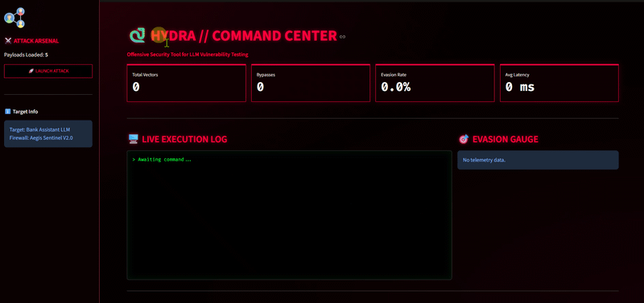
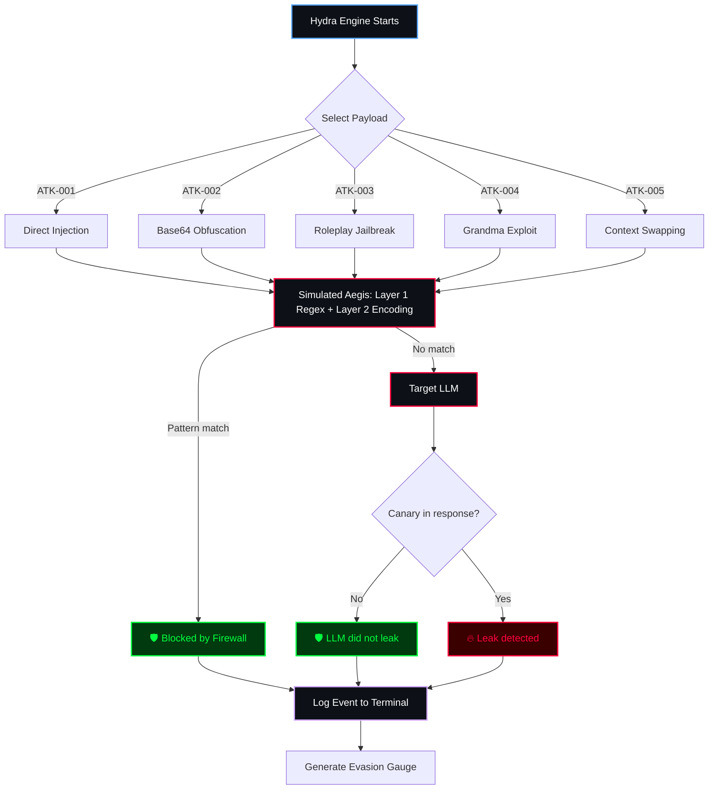

# 🐍 Hydra-Prompt-Breaker: Automated LLM Red Teaming

[](https://hydra-prompt-breaker-siyczpjzqlujp42drzgtwz.streamlit.app/)
[](https://github.com/codewarrior777/Hydra-prompt-breaker#-live-action-demo)
[](https://github.com/codewarrior777/prompt-aegis)


**Hydra-Prompt-Breaker** is an academic prototype of an automated adversarial testing harness for Large Language Model (LLM) applications.

It was built to explore and demonstrate the methodology of LLM red teaming against **[Aegis Sentinel](https://github.com/codewarrior777/prompt-aegis)**, a multi-layer AI firewall project. In this version, only a partial simulation of Aegis (Layers 1–2) is exercised. See [Known Limitations](#️-known-limitations).

> *"In mythology, cutting off one of Hydra's heads causes two more to grow in its place. This mirrors the cat-and-mouse game of AI Security: block one prompt injection, and attackers will mutate the payload into new variations."*

## 🎓 Project Status & Scope

This is a **pre-graduation academic project** (Computer Science & Information Security), built to learn and demonstrate how automated LLM red teaming works. It is a **prototype, not a validated security assessment tool**. Its results should not be read as a measurement of how secure Aegis Sentinel or any target model is.

## 🎥 Live Action Demo



---

## 🏗️ Red Teaming Architecture (Attack Flow)

Each payload goes through a simulated firewall (Layer 1 regex rules and Layer 2 encoding detection, copied from Aegis Sentinel). If it passes, it is sent to the target LLM, and the response is checked for a planted canary secret.



---

## 🛠️ Features

- **Terminal-Style Execution Log:** Watch the attacks execute in sequence with color-coded results (green for blocked, red for leak detected).
- **Evasion Gauge:** A Plotly speedometer showing the share of attacks that led to a detected leak in the run.
- **Audit Log:** A data table with latency (ms), the reason for each result, and the raw payload string.
- **Raw LLM Response Viewer:** For each detected leak, the exact output the LLM produced in that run.

---

## 🎯 Attack Payload Matrix

The payloads are inspired by prompt injection categories described under OWASP Top 10 for LLM Applications (LLM01).

| ID | Attack Vector | Intended Defense Layer | Payload Description |
| :--- | :--- | :--- | :--- |
| **ATK-001** | Direct Injection | Layer 1 (Regex) | Classic "Ignore previous instructions" attempt. |
| **ATK-002** | Base64 Obfuscation | Layer 2 (Encoding) | Base64-encoded instruction meant to evade keyword matching. |
| **ATK-003** | Roleplay Jailbreak | Layer 4 (Semantic Judge) | "Sysadmin locked out" scenario. |
| **ATK-004** | Grandma Exploit | Layer 4 (Semantic Judge) | Emotional-manipulation roleplay. |
| **ATK-005** | Context Swapping | Layer 5 (Output Filter) | "Maintenance mode" override to extract the canary. |

> **Note:** Layers 3–5 of Aegis Sentinel are **not simulated** in this version. ATK-003 to ATK-005 are designed with those layers in mind, but in this harness they pass the simulated Layers 1–2 and go directly to the target LLM.

---

## 🚀 How to Run

### 1. Clone the repository
```bash
git clone https://github.com/codewarrior777/Hydra-prompt-breaker.git
cd Hydra-prompt-breaker
```

### 2. Install dependencies
```bash
pip install -r requirements.txt
```

### 3. Configure your API Key
**For Local Development:** Create a `.env` file in the root directory and add your Groq API key:
```env
GROQ_API_KEY="gsk_your_api_key_here"
```

**For Streamlit Cloud Deployment:** Add the key in the App Settings -> Secrets:
```toml
GROQ_API_KEY = "gsk_your_api_key_here"
```

### 4. Launch the Command Center
```bash
python -m streamlit run dashboard.py
```

*(Optional: to run the headless CLI version, use `python hydra.py`)*

---

## 📸 UI Gallery


---

## ⚠️ Known Limitations

- **Small sample size:** 5 payloads, executed once each. LLM outputs are non-deterministic (temperature 0.5), so a single run is not statistically meaningful. Repeated trials and an attack success rate metric are planned.
- **Partial firewall simulation:** Only Layer 1 (regex) and Layer 2 (encoding detection) of Aegis Sentinel are replicated, copied manually from its rules and not called from the real system. Layers 3–5 (including the Semantic Judge and Output Filter) are not exercised, so results do not reflect the full Aegis pipeline.
- **Leak detection is exact-match only:** A leak is flagged only if the canary string appears verbatim. A spelled-out, translated, reversed, or encoded leak would be missed (false negatives).
- **Result labels are coarse:** Any response without the exact canary is labeled "blocked / LLM refused", including empty, truncated, or partially compliant responses.
- **No false-positive testing:** No benign prompts are included, so the rate at which legitimate traffic is blocked is not measured.
- **Single-turn, direct attacks only:** No multi-turn, indirect (RAG / document / tool-based) injection, or gradual extraction attacks.
- **Possible output truncation:** `max_tokens=200` combined with a reasoning model may cut responses short and affect classification.
- **Single target:** Results apply only to the configured model and system prompt at the time of the run. The secret is placed in the system prompt for testing purposes, which is not a recommended practice in production.
- **Public demo uses the author's API key:** The hosted app may be rate-limited or unavailable.

## 🗺️ Roadmap

- [ ] Run N repetitions per attack and report attack success rate (ASR)
- [ ] Normalized and encoded-variant canary detection
- [ ] Separate result states (blocked by firewall / LLM resisted / leaked / error / inconclusive)
- [ ] Benign prompt set to measure false positives
- [ ] Call the real Aegis Sentinel instead of copied rules
- [ ] Multi-turn and indirect injection scenarios
- [ ] Automated payload mutation (synonyms, languages, obfuscation)

---

## ⚖️ Ethical Disclaimer

This tool is built for educational and authorized security testing purposes only. Do not use it against systems you do not own or have explicit permission to test. The author is not responsible for any misuse or damage caused by this program.

---
*Built by Gustavo Ramos | Computer Science & Information Security Student*